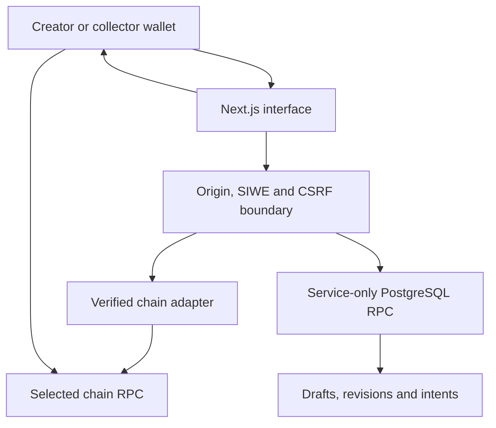

# Architecture

The browser connects wallets and renders a shared workspace. A single typed/validated Next.js POST dispatcher receives `{op,p}`; the server owns authorization, chain reads, simulation and database access. The browser receives exact unsigned transaction calldata and asks its connected wallet to execute it. Private keys never reach the application server.

## Identity and authority

A collection is identified by `(chain_id, lowercased address)`, not by its first registered wallet. Page identities add token ID and a unique slug and cannot be mutated. Every private workspace request verifies a fresh owner/ADMIN_ROLE result at one block. A revoked admin's old SIWE session does not confer continuing collection access. Collector intents are private to their actor; current admins can inspect their collection's administration/publication history.

SIWE messages are issued server-side and stored as single-use challenges. The browser-bound challenge cookie, domain, URI, chain, nonce, expiry and signature are all checked. Sessions use random opaque tokens; only hashes are stored. Mutating/private requests require exact configured origin and a random session-bound CSRF value. SameSite cookies are strict and HttpOnly protects the session cookie; HTTPS makes it Secure.

## Data model

- `collections`: chain/address namespace.
- `mint_pages`: current draft, optimistic version, publication state, accepted on-chain fingerprint and current published revision.
- `mint_page_revisions`: immutable editor-stamped snapshots.
- `publication_records`: transaction review, actor, chain, calldata, expected snapshot, hash, nonce, status and receipt.
- `audit_logs`: draft saves, accepted snapshots and publication results.
- `auth_challenges`, `app_sessions`, `rate_limits`: authentication and API protection.
- `collection_profiles`, `media_assets`: reserved tables; upload/pinning integration is not implemented in this release.

All ten tables enable RLS. Browser roles have no data grants or policies. `tcm_command` is SECURITY INVOKER; PUBLIC, anon and authenticated cannot execute it. Only service_role receives the required data/sequence/function grants. This server-only design intentionally uses fresh chain authority rather than caching wallet membership in RLS policies. Protecting the server service-role secret is therefore critical. A separate scoped database role and further segmentation may be added for a production threat model.

## Publication

| State            | Meaning                                                                                    |
| ---------------- | ------------------------------------------------------------------------------------------ |
| DRAFT            | An editable revision has been saved                                                        |
| READY_FOR_REVIEW | On-chain baseline accepted or a transaction review prepared                                |
| PUBLISHING       | A matching submitted transaction has been attached                                         |
| PUBLISHED        | Finalized transaction and readback match, or content-only publication explicitly confirmed |
| PUBLISH_FAILED   | Submitted transaction reverted                                                             |
| OUT_OF_SYNC      | Expected configuration/round differs from live readback                                    |
| ACTION_REQUIRED  | Permission, token lock, minter permission, replacement or revision requires attention      |

A saved draft does not automatically replace a public revision. Public readers always resolve `published_revision`. Every public page also reads live Stacks state and refuses minting when it diverges from the expected configuration, is paused/unapproved or the token is locked. Supply changes caused by normal purchases do not create false configuration conflicts.

An active drop with several changed fields produces several reviews. After each confirmed step, the current baseline advances; publication remains incomplete until all intended fields match. Changes made outside this application are shown for explicit baseline acceptance. They are never silently overwritten.

## Transactions and recovery

1. Verify chain, exact runtime and current authority.
2. Build only an allowlisted call, simulate and estimate gas.
3. Save a five-minute review with immutable calldata, value and expected state.
4. Show addresses, arguments, fees, chain and calldata in the wallet review.
5. Immediately recheck authority, state, phase, quantity and simulation before signing.
6. Wallet sends; browser retains the hash even if the API is temporarily unavailable.
7. Server attaches only a matching sender/destination/calldata/value transaction.
8. Verify canonical receipt and wait for the chain's `finalized` block (local Anvil skips the wait).
9. Read back expected configuration and round before publishing.

A speed-up must retain the original nonce and exact action. A changed-action replacement/cancellation must use the actor's saved nonce and have a canonical finalized receipt. The nonce is saved before the original transaction can disappear from an RPC's mempool. Retrying status checks is safe; the app never retries a wallet send automatically.

If a provider does not support the `finalized` tag, publication stays pending rather than guessing that one confirmation is enough. Operators need production RPCs with the required history and finality support.

## Media

Metadata is parsed as JSON and only bounded text/image/attribute fields are returned. Text is rendered through React, without raw HTML. IPFS and explicitly operator-approved HTTPS hosts are permitted; redirects, private DNS results, local literal hosts, excessive sizes and long requests are rejected. Raster magic bytes are required for served image responses; SVG/HTML are not served. Approved HTTPS hostname ownership is part of the operator trust boundary. IPFS uploads/pinning and storage billing are not configured.

## Extending adapters

Add a new allowlisted runtime and source pin to the registry, a compatible server adapter, permission semantics, call builders, state reconciliation and success/failure fixtures. Do not accept a new contract merely because it advertises ERC-1155 or exposes similarly named functions. General proxy storage slots and unverified upgradeable proxy families are not inferred automatically.
